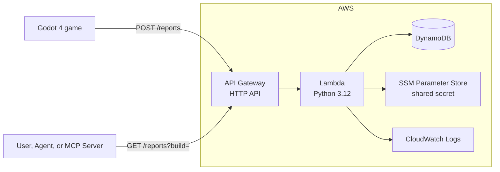

# playtest-reports

Serverless bug-report backend for my Godot project. The game POSTs a report with context (build, scene, position, FPS, a snapshot of various player states), and I list reports by build, newest first.

Built with API Gateway (HTTP API), a Python 3.12 Lambda and DynamoDB, deployed with Terraform and GitHub Actions using OIDC.

## Architecture



The infrastructure is split into two Terraform stacks:

- `bootstrap/`: the S3 state bucket, the GitHub OIDC provider and the deploy role. Applied once, by hand.
- `infra/`: everything in the diagram. Applied by GitHub Actions.

## API

Both routes need an `x-playtest-secret` header.

**`POST /reports`**

```json
{
  "build": "0.4.2",
  "scene": "res://levels/forest.tscn",
  "position": { "x": 12.5, "y": 0, "z": -3.25 },
  "fps": 58.2,
  "category": "bug",
  "message": "Fell through the floor near the bridge",
  "gameState": { "v": 1, "weapon": { "name": "shotgun", "action": "Reloading/Default" } }
}
```

`category` is `bug`, `crash` or `feedback`. `gameState` is optional and free-form. Invalid input gets a 400 that lists every problem; success returns 201 with the report's `id`.

**`GET /reports?build=0.4.2`** returns `{"reports": [...], "nextToken": "..."}`, newest first. Pass `nextToken` back to get the next page (`limit` defaults to 25, maximum 100).

## CI/CD

- **Pull requests:** pytest, `terraform fmt -check`, `validate` and `plan`.
- **Push to `main`:** pytest, then `terraform apply`, in a concurrency group so applies never overlap.

GitHub Actions signs in to AWS with OIDC, so no AWS keys are stored in GitHub. The deploy role only trusts this repository's `main` branch and pull requests. It can only create IAM roles that carry a permissions boundary, so it can't be used to make a more powerful role.

## Setup

Needs the AWS CLI, Terraform 1.16 and Python 3.12.

```bash
pip install -r requirements-dev.txt
pytest

terraform -chdir=bootstrap init
terraform -chdir=bootstrap apply

aws ssm put-parameter --name /playtest-reports/shared-secret --type SecureString \
  --value "$(python -c 'import secrets; print(secrets.token_hex(32))')"

terraform -chdir=infra init
terraform -chdir=infra apply
```

On a new account, the state bucket doesn't exist yet: comment out the backend block in `bootstrap/terraform.tf` for the first apply, then put the new bucket name in both backend blocks and run `terraform -chdir=bootstrap init -migrate-state`. Finally, add the deploy role's ARN (`terraform -chdir=bootstrap output -raw deploy_role_arn`) as a repository secret named `AWS_ROLE_ARN`.

## Design notes

- **DynamoDB keys:** partition key `build`, sort key `<timestamp>#<id>`. Listing a build is a single Query, newest first.
- **The secret never touches Terraform.** I create it by hand as a SecureString, and Terraform only references its name, so the value never ends up in state.
- **The deploy role's policy** was generated from the Terraform plans with IAM Policy Autopilot, then narrowed to this project's resources.
- **Throttling:** API Gateway allows 5 requests/second (burst 10), but that's best-effort. In testing, the real ceiling was the account's Lambda concurrency limit of 10, which returns 503s, so clients should retry 429 and 503 with backoff.
- **Trade-off:** the shared secret ships inside the game build. That's fine for playtests, but a public release would need per-player authentication.

## Cost

At playtest volume it costs next to nothing: 10,000 reports a month is a few cents, mostly API Gateway and DynamoDB requests, and the Lambda usage stays inside its free tier. Throttling, the Lambda concurrency limit and 7-day log retention keep it bounded.
